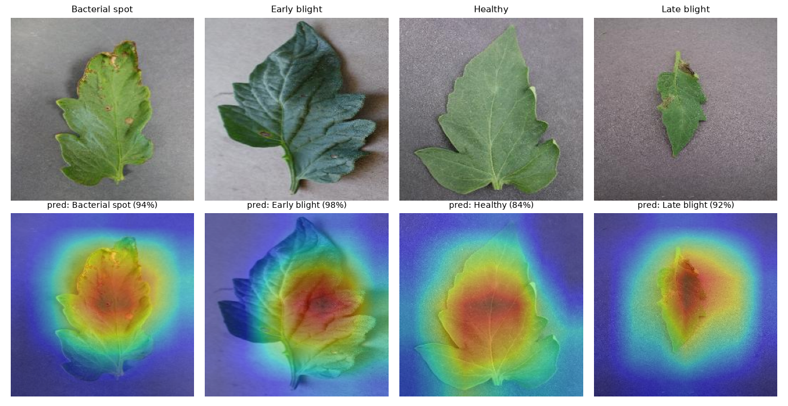
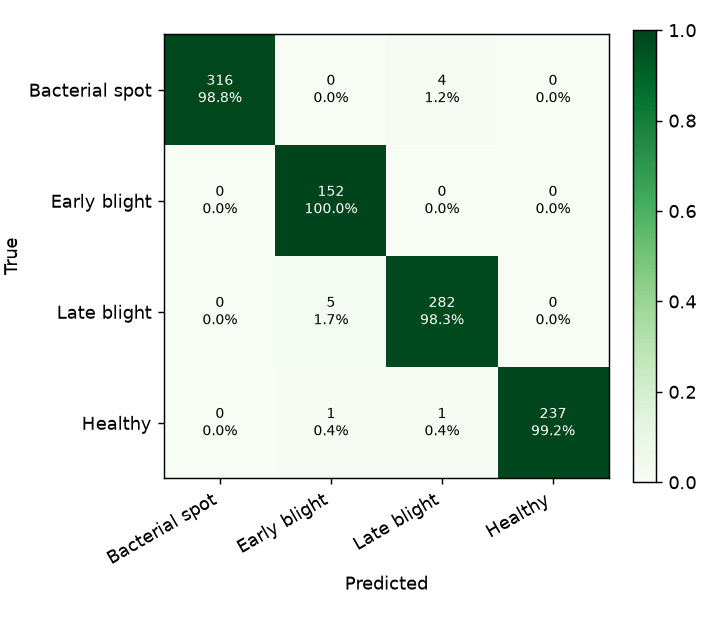
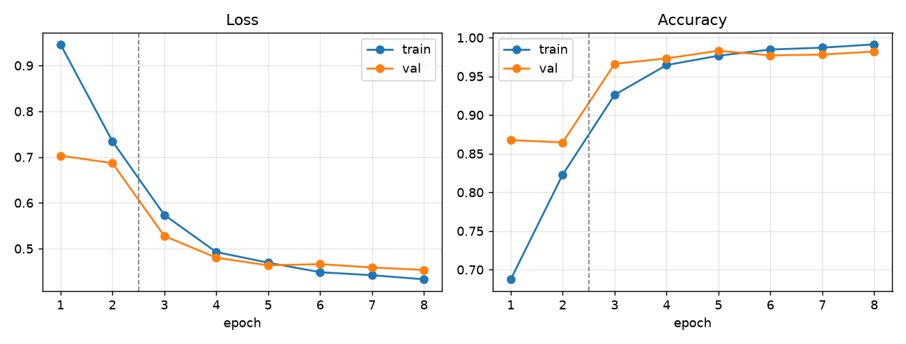

# Tomato Leaf Disease Classifier

A ResNet18 model that sorts photos of tomato leaves into four classes (bacterial spot, early blight, late blight, healthy). It's trained on the [PlantVillage](https://github.com/spMohanty/PlantVillage-Dataset) dataset and comes with a Streamlit app that shows Grad-CAM heatmaps next to each prediction.

**98.9% test accuracy / 0.988 macro-F1** on a test set that shares no leaves with the training data.



## The data leakage problem

PlantVillage often has several photos of the **same physical leaf**. My first version split the images at random, and when I checked against the dataset's `leaf-map.json` (which links each photo to its leaf), the result was bad:

| Split | Images with a known leaf ID | Same leaf also in train |
|---|---|---|
| val  | 750 | **734 (98%)** |
| test | 762 | **747 (98%)** |

So the test score was mostly measuring whether the model recognised leaves it had already seen. `split_dataset.py` now splits **by leaf**. Each class is shuffled at the leaf level and whole leaves go into train/val/test (70/15/15) until each split reaches its share. Images with no leaf mapping are treated as their own group. The script finishes by re-checking for overlap and reports 0/1004 for val and 0/998 for test.

## Results

All numbers are on the leaf-grouped test set (998 images, never used for training or model selection).

| | Test accuracy | Macro F1 |
|---|---|---|
| v1: frozen ResNet18, random split (leaky) | 94.0% | 0.93 |
| **v2: two-stage fine-tune, leaf-grouped split** | **98.9%** | **0.988** |

The v1 number is shown for reference only. It was measured on a leaky test set, so it isn't a fair comparison, and the real gap is likely larger than it looks.

| Class | Precision | Recall | F1 | Test images |
|---|---|---|---|---|
| Bacterial spot | 1.000 | 0.988 | 0.994 | 320 |
| Early blight   | 0.962 | 1.000 | 0.981 | 152 |
| Late blight    | 0.983 | 0.983 | 0.983 | 287 |
| Healthy        | 1.000 | 0.992 | 0.996 | 239 |

<p>
  
  
</p>

Most of the remaining errors are between early and late blight, which also look alike to the eye early on. See [reports/misclassified.png](reports/misclassified.png) for the most confident mistakes.

### Robustness

PlantVillage photos are taken in a lab against a plain grey background, so a high score here doesn't mean the model will work in a field. As a rough stress test, `evaluate.py --robustness` re-runs the test set with simple image corruptions:

| Corruption | Accuracy |
|---|---|
| none | 98.9% |
| darker (×0.5) | 97.1% |
| brighter (×1.6) | 97.4% |
| low contrast | 96.5% |
| JPEG quality 20 | 96.5% |
| Gaussian noise (σ=20) | 93.1% |
| **Gaussian blur (r=2)** | **74.3%** |

Lighting and compression changes are handled fine, thanks mostly to the colour-jitter augmentation. Blur is the weak point: the model relies on fine lesion texture, and that's the first thing an out-of-focus phone photo loses. Adding blur augmentation would be the obvious next step.

## How it works

- **Model:** ImageNet-pretrained ResNet18 with a new dropout + linear head. The code also supports `resnet50`, `efficientnet_b0` and `mobilenet_v3_large` through `--arch`.
- **Stage 1 (2 epochs):** backbone frozen, only the head is trained (AdamW, lr 1e-3).
- **Stage 2 (up to 6 epochs):** `layer3` and `layer4` are unfrozen. The backbone uses lr 1e-4 and the head 5e-4, with a cosine schedule and early stopping on validation loss.
- **Loss:** cross-entropy with label smoothing (0.1) and inverse-frequency class weights, because early blight has about half as many images as the other classes.
- **Augmentation:** random resized crop, horizontal/vertical flips, rotation and colour jitter.
- **Explainability:** a small Grad-CAM implementation (`plant_disease/gradcam.py`) that hooks the last ResNet block, used by both the CLI and the app.

Training takes about 30 minutes on a 6-core CPU with no GPU.

## Project layout

```
plant_disease/        library code
  data.py             transforms, loaders, leaf-grouped split
  model.py            model building, freezing, checkpoint I/O
  engine.py           train / eval loop
  gradcam.py          Grad-CAM + overlay
  predictor.py        inference wrapper used by the app and CLI
split_dataset.py      raw images -> data/{train,val,test}
train.py              two-stage fine-tuning
evaluate.py           metrics, confusion matrix, robustness tests
predict.py            command-line inference
inspect_data.py       class counts + sample grid
app.py                Streamlit app
tests/                pytest unit tests (no dataset needed)
reports/              generated metrics and figures
```

## Running it

```bash
python -m venv .venv && source .venv/bin/activate
pip install -r requirements.txt

# get the raw images (only the tomato folders are used)
git clone https://github.com/spMohanty/PlantVillage-Dataset plantvillage-source

python split_dataset.py --classes Tomato___Bacterial_spot Tomato___Early_blight \
                                  Tomato___Late_blight Tomato___healthy
python train.py
python evaluate.py --robustness
```

Try the trained model:

```bash
python predict.py assets/samples/early_blight_1.jpg --gradcam out/
streamlit run app.py
```

Tests:

```bash
pip install -r requirements-dev.txt
pytest
```

## Limitations

- Only 4 of the 10 tomato classes in PlantVillage are included.
- All training images are single leaves on a plain background. Real photos with soil, other leaves or hands in the frame are out of distribution, and the app only warns when confidence drops below 70%.
- Grad-CAM shows where the model looked, not why. On a few healthy leaves it highlights the whole leaf instead of any specific region.

## Credits

Dataset: Hughes & Salathé, *An open access repository of images on plant health to enable the development of mobile disease diagnostics* (2015), and Mohanty, Hughes & Salathé, *Using Deep Learning for Image-Based Plant Disease Detection* (2016). The leaf grouping file comes from the PlantVillage-Dataset repository.
